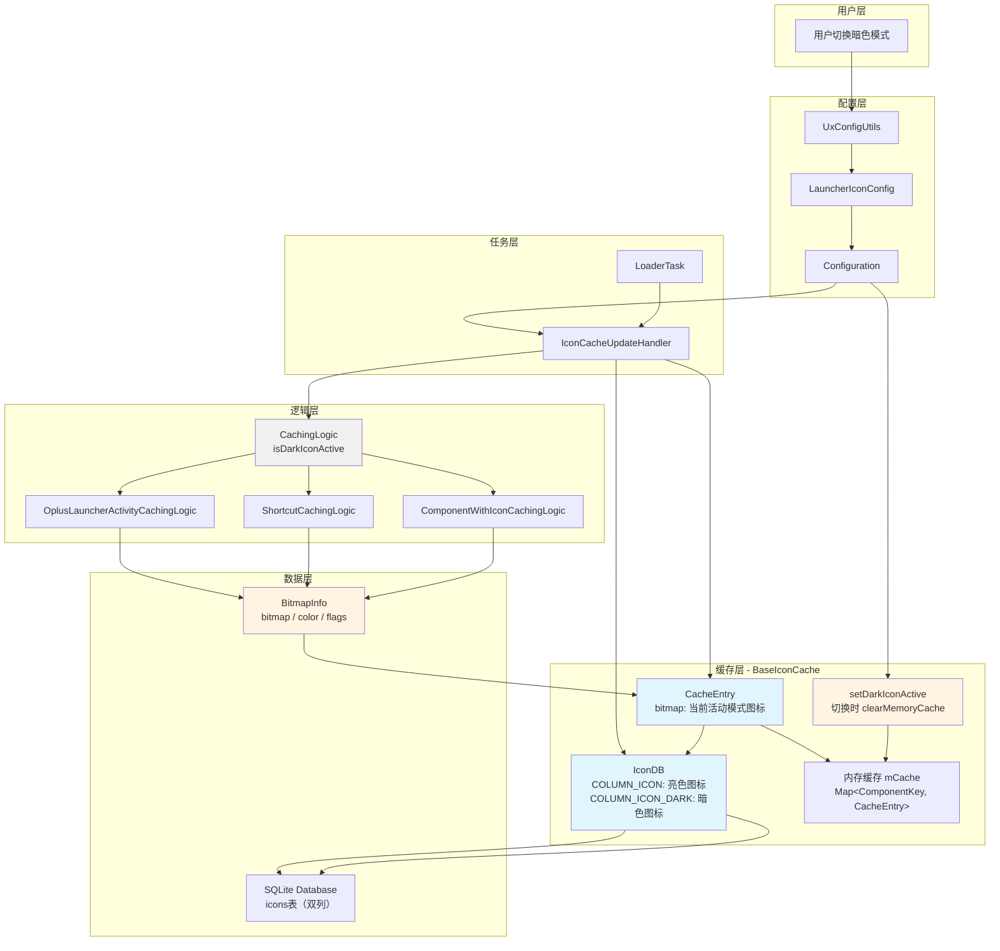
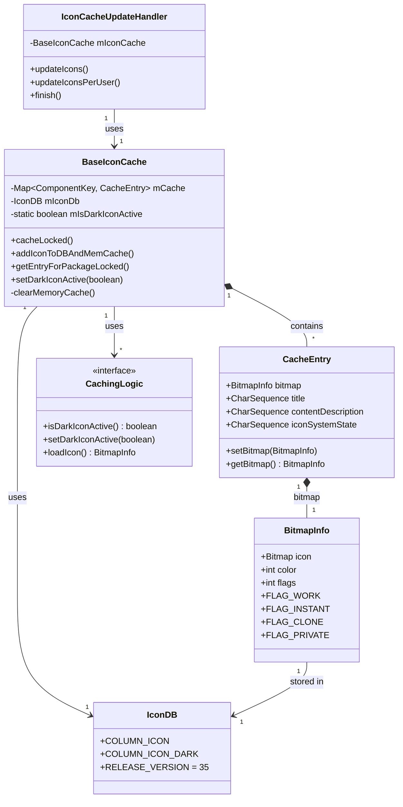
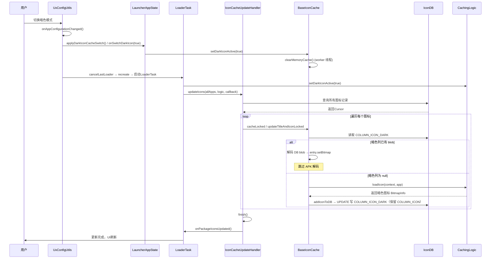
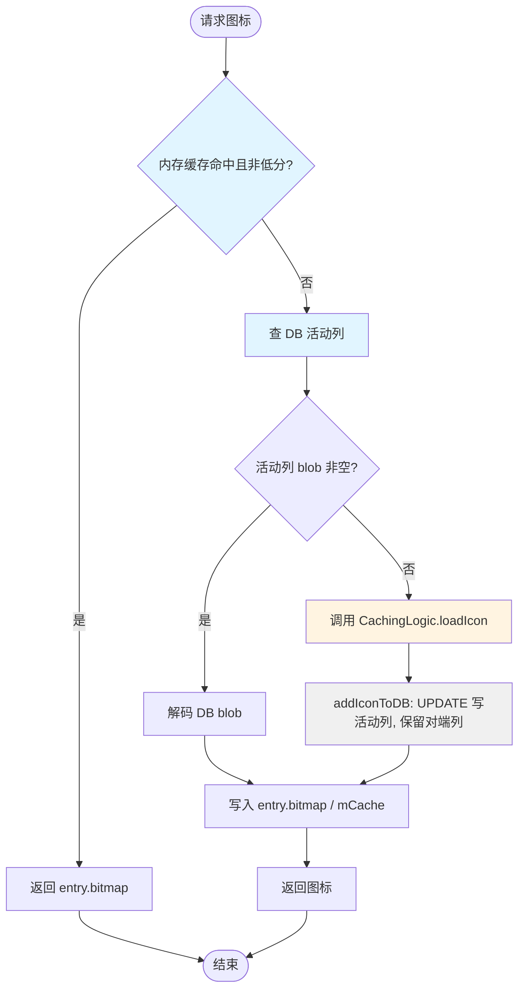
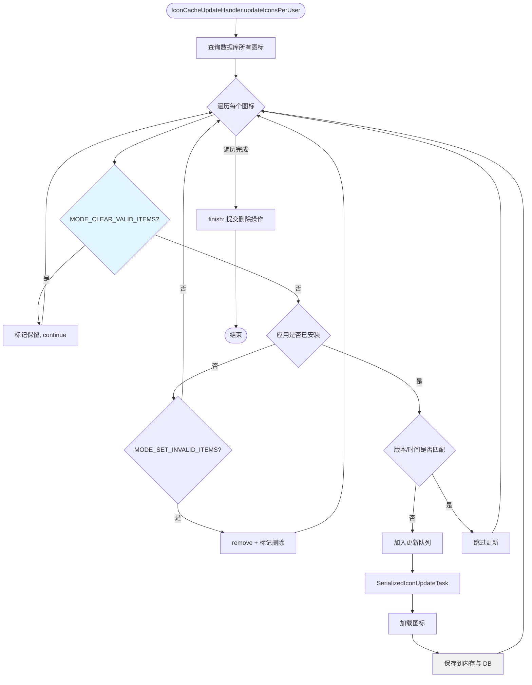
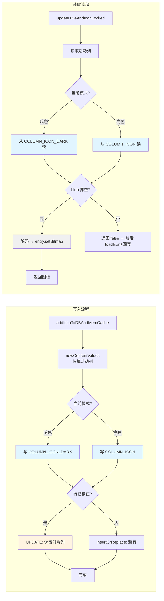
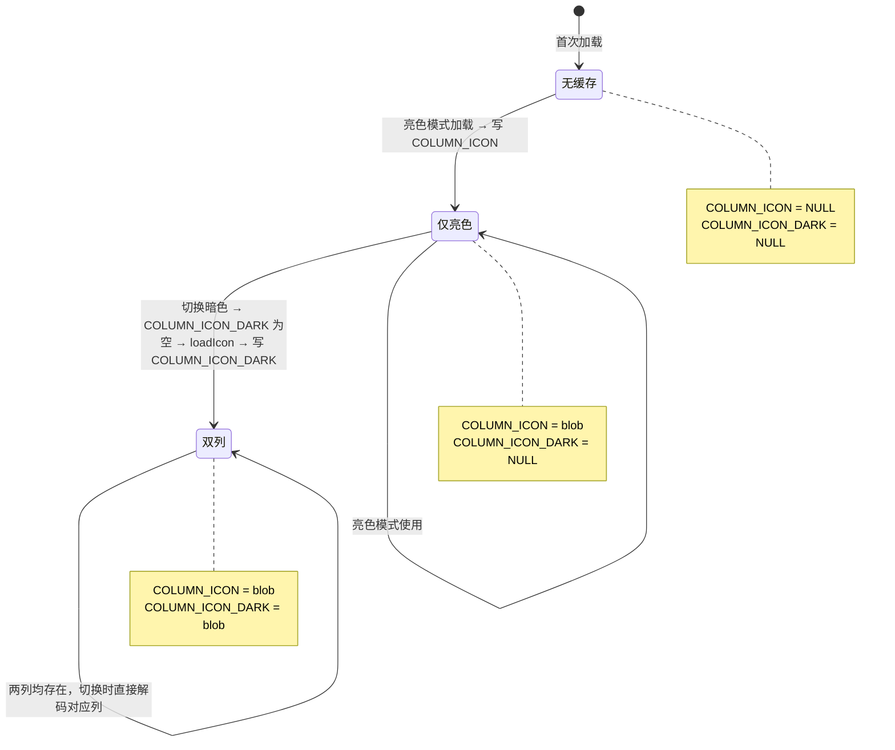
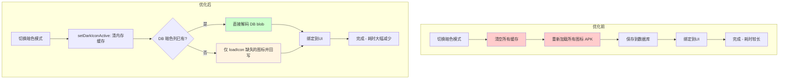

# 暗色模式图标加载流程优化方案

## 一、优化方案概述

### 1.1 背景
在切换暗色模式时，桌面需要重新加载所有应用的图标。原有实现中，每次切换模式都需要：
- 清空图标缓存
- 重新加载所有图标资源
- 重新绑定到UI

这导致切换暗色模式时加载时间较长，用户体验不佳。

### 1.2 优化目标
**优化桌面切换暗色模式时的图标加载时长**，通过以下方式实现：
- 数据库同时持久化亮色和暗色两种模式的图标（双列 `icon` / `icon_dark`）
- 内存缓存每个条目只保留当前活动模式的一份 bitmap
- 切换模式时清空内存缓存，重读 DB 对应列；若该列已由上一次对应模式的加载写入，则直接从 DB 解码，不必再走 APK 解码

### 1.3 提交信息
- **提交1 (42177815)**: `[APP.Launcher][1/2]{【Feature】【16.1】切换暗色模式图标加载流程优化}`
- **提交2 (42178965)**: `[JAR.settingslib][2/2]{【Feature】【16.1】切换暗色模式图标加载流程优化}`

> 注：本方案经过单 Bitmap 化重构。早期方案在内存 `CacheEntry` 中同时持有 `bitmap`/`bitmapDark` 双槽并用 `FLAG_ICON_CACHE_VALID` / `FLAG_ICON_CACHE_DARK_VALID` 标志位追踪 DB 有效性；现行方案已移除内存双槽与标志位，改为"内存单 bitmap + DB 双列 + 切换时清内存重读"。下文描述的是现行方案。

---

## 二、核心优化方案

### 2.1 双模式图标缓存机制

#### 2.1.1 CacheEntry：内存单 bitmap
**位置**: `BaseIconCache.CacheEntry`

**核心改动**:
```java
public static class CacheEntry {
    @NonNull
    public BitmapInfo bitmap = BitmapInfo.LOW_RES_INFO;   // 当前活动模式的图标
    @NonNull
    public CharSequence title = "";
    @NonNull
    public CharSequence contentDescription = "";
    public CharSequence iconSystemState;

    public void setBitmap(@NonNull BitmapInfo bitmap) { this.bitmap = bitmap; }
    @NonNull
    public BitmapInfo getBitmap() { return bitmap; }
}
```

> 单 Bitmap 化说明：每个 `CacheEntry` 只保留一份 `bitmap`，对应**当前活动模式**。
> 对端（非活动）模式的图标**不驻留内存**，只存在于 DB 的双列结构中。
> 切换模式时清空整个内存缓存 `mCache`，使后续读取命中 DB 对应列并重新写入 `bitmap`。
> 因此 `CacheEntry` 不再需要 `mIsDarkIconActive` 字段、`getBitmap(boolean)` 探测方法，
> 也不再有 `setBitmap(BitmapInfo, boolean)` / `setDarkIconActive(boolean)` 等双槽接口。

**关键方法**:
- `setBitmap(BitmapInfo)`: 设置当前活动模式的图标
- `getBitmap()`: 获取当前活动模式的图标

#### 2.1.2 数据库结构：双列持久化
**位置**: `BaseIconCache.IconDB`

**核心改动**:
```java
// 暗色图标列
public static final String COLUMN_ICON_DARK = "icon_dark";

// 数据库版本升级
private static final int RELEASE_VERSION = 35;  // 从34升级到35

// 创建表时添加暗色图标列
CREATE TABLE ... (
    ...
    COLUMN_ICON BLOB,           // 亮色图标
    COLUMN_ICON_DARK BLOB,      // 暗色图标
    ...
)
```

> 一行 DB 记录同时保存亮色（`COLUMN_ICON`）与暗色（`COLUMN_ICON_DARK`）两份图标。
> 读取时按 `BaseIconCache.mIsDarkIconActive` 选择列；写入时只写活动列。
> 为了在写活动列时不破坏对端列，`addIconToDB` 对已存在的行使用 UPDATE（而非 REPLACE）。

### 2.2 有效性判定：列非空，而非标志位

现行方案**不再使用** `FLAG_ICON_CACHE_VALID` / `FLAG_ICON_CACHE_DARK_VALID` 等标志位
（已从 `BitmapInfo` 中删除，连同 `isIconCacheValidFlagsInDB` / `setIconCacheValidFlags` /
`haveAllIconCacheInDB` 等位运算方法）。

DB 中某模式图标是否有效，直接由**该列的 BLOB 是否为 null** 决定：
```java
// BaseIconCache.updateTitleAndIconLocked()
byte[] data = (mIsDarkIconActive ? c.getBlob(IconDB.INDEX_ICON_DARK)
                                 : c.getBlob(IconDB.INDEX_ICON));
if (data == null) {
    return false;   // 当前活动列无数据 → 触发从 APK 重新加载并回写 DB
}
// 否则解码 DB 中的 blob，写入 entry.bitmap
```

`flags` 列仍然读写，但只承载用户标志位（`FLAG_WORK` / `FLAG_INSTANT` / `FLAG_CLONE` /
`FLAG_PRIVATE`），不再承载缓存有效性位。

### 2.3 CachingLogic 接口

**位置**: `CachingLogic.java`

保留的接口方法:
```java
// 判断当前是否使用暗色图标
default boolean isDarkIconActive() { return false; }
default void setDarkIconActive(boolean darkIconActive) { }
```

> `isInSwitchingIcon()` / `setInSwitchingIcon(boolean)` 已移除（含 `BaseCachingLogic` 中的
> `mIsInSwitchingIcon` 字段及实现）。现行方案不再有"切换中"的中间态——切换即清内存缓存重读。

**实现类**:
- `OplusLauncherActivityCachingLogic`: 应用图标缓存逻辑
- `ShortcutCachingLogic`: 快捷方式图标缓存逻辑
- `ComponentWithIconCachingLogic`: Widget图标缓存逻辑

### 2.4 图标更新逻辑

#### 2.4.1 IconCacheUpdateHandler
**位置**: `IconCacheUpdateHandler.java`

由于不再有"切换中保留"语义，`updateIconsPerUser` 的过滤逻辑被简化：
```java
if (mFilterMode == MODE_CLEAR_VALID_ITEMS) {
    mItemsToDelete.put(rowId, false);
    continue;
}
if (app == null) {
    if (mFilterMode == MODE_SET_INVALID_ITEMS) {
        mIconCache.remove(component, user);
        mItemsToDelete.put(rowId, true);
    }
} else {
    appsToUpdate.add(app);
}
```

> 不再有 `isInSwitchingIcon()` 分支，也不再有按 `FLAG_ICON_CACHE_*` 跳过更新的判断。

#### 2.4.2 数据库写入：UPDATE 保留对端列
**位置**: `BaseIconCache.addIconToDB(...)`

```java
// 一行同时存亮色 COLUMN_ICON 与暗色 COLUMN_ICON_DARK。newContentValues 只填活动列，
// 因此绝不能用 insertOrReplace：REPLACE 会整行删除再插入，把另一模式列清成 NULL。
// 改为：行已存在则 UPDATE（只动活动列，保留对端列）；新行才 insertOrReplace。
String whereClause = IconDB.COLUMN_COMPONENT + " = ? AND " + IconDB.COLUMN_USER + " = ?";
String[] whereArgs = new String[]{ key.flattenToString(), Long.toString(userSerial) };
if (iconRowExists(whereClause, whereArgs)) {
    mIconDb.updateWithOnConflict(values, whereClause, whereArgs);
} else {
    mIconDb.insertOrReplace(values);
}
```

`newContentValues` 只写活动列：
```java
values.put((mIsDarkIconActive ? IconDB.COLUMN_ICON_DARK : IconDB.COLUMN_ICON), flattenedBitmap);
```

> 早期方案在写活动列前会调用 `getOtherIconBlobFromDb` 把对端 bitmap 取回内存、连同活动列一起整行
> 写入。该方法已删除——双列各自独立写、互不覆盖。

#### 2.4.3 数据库读取：按活动列解码
**位置**: `BaseIconCache.updateTitleAndIconLocked(...)`

```java
byte[] data = (mIsDarkIconActive ? c.getBlob(IconDB.INDEX_ICON_DARK)
                                 : c.getBlob(IconDB.INDEX_ICON));
if (data == null) {
    return false;   // 活动列为空 → 上层触发 loadIcon + addIconToDB
}
// 解码并写入 entry.bitmap，flags 取自 cursor
BitmapInfo bi = entry.getBitmap();
bi.flags = c.getInt(IconDB.INDEX_FLAGS);
bi.setUserHandle(cacheKey.user);
```

#### 2.4.4 模式切换：清内存缓存
**位置**: `BaseIconCache.setDarkIconActive(boolean)`

```java
public void setDarkIconActive(boolean darkIconActive) {
    boolean changed = mIsDarkIconActive != darkIconActive;
    mIsDarkIconActive = darkIconActive;
    if (changed) {
        // 活动模式已切换：内存中每个 entry 仍持有上一模式的 bitmap，
        // 直接清空整个内存缓存，使后续读取重新从 DB（双列）读取对应列。
        // 在 worker 线程执行，与所有缓存读写保持串行（mCache 是普通 HashMap）。
        mWorkerHandler.post(this::clearMemoryCache);
    }
}

private synchronized void clearMemoryCache() {
    mCache.clear();
}
```

> 这是本方案的核心：切换模式不清 DB，只清内存缓存。下一次读取命中 DB 对应列——
> 若该列已由上一次对应模式的加载写入，则直接解码 DB blob（省去 APK 解码）；
> 若为 null，则走 loadIcon + addIconToDB 回填该列。

#### 2.4.5 插件图标获取优化
**位置**: `ComponentWithIconCachingLogic.loadIcon(Context context, ComponentWithLabelAndIcon object)`

```java
// 使用默认图标的Widget需要特殊处理，直接使用App包IconCache
if (object instanceof LauncherAppWidgetProviderInfo widgetInfo
                    && isUsingAppDefaultIcon(context, widgetInfo)) {
    IconCache iconCache = LauncherAppState.getInstance(context).getIconCache();
    PackageItemInfo pkgInfo = new PackageItemInfo(widgetInfo.provider.getPackageName(), widgetInfo.getUser());
    iconCache.getTitleAndIconForApp(pkgInfo, false);           
}
```
---

## 三、关键流程

### 3.1 图标加载流程（优化后）

#### 场景1: 首次加载（亮色模式）
1. `LoaderTask` 启动，调用 `IconCacheUpdateHandler.updateIcons()`
2. 遍历所有应用，调用 `BaseIconCache.cacheLocked()`
3. 检查内存缓存 → 检查数据库缓存
4. 如果 DB 活动列（`COLUMN_ICON`）为 null，调用 `CachingLogic.loadIcon()` 加载图标
5. 保存到内存缓存和数据库（`COLUMN_ICON`）

#### 场景2: 切换到暗色模式
1. `UxConfigUtils.onAppConfigurationChanged()` 检测到模式切换
2. `applyDarkIconCacheSwitch()`：同步 pref、`app.isDarkIconActive=true`、
   `model.cancelLastLoader()`、`OplusUIEngine.resetAppsIconsCtrl()`
3. `Launcher.onConfigurationChanged` → `launcher.recreate()`
4. `LoaderTask` 重新启动，`BaseIconCache.setDarkIconActive(true)` 触发 `clearMemoryCache()`
5. `IconCacheUpdateHandler.updateIcons()` 遍历；读取时 `updateTitleAndIconLocked` 取 `COLUMN_ICON_DARK`
    - 若 `COLUMN_ICON_DARK` 已有 blob（上一次暗色模式写入过）→ 直接解码，跳过 APK 解码
    - 若为 null → `loadIcon` 加载并 `addIconToDB` 回写 `COLUMN_ICON_DARK`（UPDATE 保留 `COLUMN_ICON`）

#### 场景3: 再次切换回亮色模式
1. 检测到模式切换，`setDarkIconActive(false)` 清内存缓存
2. 读取取 `COLUMN_ICON`，该列早已存在 → 直接解码，无需 APK 重载

### 3.2 图标缓存查询流程

```
用户请求图标
    ↓
BaseIconCache.cacheLocked()
    ↓
内存缓存 mCache 命中且 bitmap 非低分？ 
    ↓ 是 → 返回 entry.bitmap
    ↓ 否 → 查 DB 活动列（updateTitleAndIconLocked）
              ↓ 列非空 → 解码并 setBitmap，返回
              ↓ 列为空 → loadIcon + addIconToDB 回填，返回
```

### 3.3 数据库读写流程

#### 写入流程:
```
addIconToDBAndMemCache()
    ↓
newContentValues(bitmap, ...)   // 仅填活动列
    ↓
addIconToDB()
    ↓
行存在？ → UPDATE（保留对端列）
行不存在？ → insertOrReplace（新行）
    ↓
内存缓存 mCache.put（活动模式 bitmap）
```

#### 读取流程:
```
updateTitleAndIconLocked(cursor)
    ↓
读取活动列 → COLUMN_ICON 或 COLUMN_ICON_DARK
    ↓
blob 为 null？ → 返回 false（触发 loadIcon + 回写）
blob 非空？ → 解码 → bitmap.flags = cursor.flags → entry.setBitmap(bitmap)
```

---

## 四、优化效果

### 4.1 性能提升
- **首次切换**: 需要加载所有暗色图标（不可避免，回写 `COLUMN_ICON_DARK`）
- **再次切换**: 直接从 DB 对应列解码，无需重新走 APK 解码
- **部分更新**: `updateIconsPerUser` 只把仍缺失/版本变更的加入更新队列

### 4.2 存储开销
- **数据库**: 每个图标增加一个 `BLOB` 字段（暗色图标）
- **内存**: 每个 `CacheEntry` 只持有一份 `BitmapInfo`（活动模式），相比早期双槽方案内存更低
- **权衡**: 以少量 DB 空间换取切换时的加载速度提升

### 4.3 兼容性
- **数据库版本**: 从34升级到35，自动迁移
- **向后兼容**: 旧版本数据自动适配
- **有效性判定**: 由列非空决定，无需维护与数据可能不同步的标志位

---

## 五、关键技术点

### 5.1 线程安全
- `BaseIconCache` 使用 `synchronized` / worker 线程保护关键操作
- `mCache` 是普通 `HashMap`，所有读写都在 worker 线程上串行；`clearMemoryCache` 也 post 到 worker 线程执行，避免与读写竞争

### 5.2 缓存一致性
- 活动模式由全局 `BaseIconCache.mIsDarkIconActive` 决定，读写列都依此选择
- 切换模式即清内存缓存，不存在"内存中持有上一模式 bitmap 却被当作当前模式"的窗口
- DB 双列各自独立写、UPDATE 不覆盖对端列，保证两份图标共存

### 5.3 内存优化
- 使用 `addToMemCache()` 控制是否加入内存缓存
- 低分辨率图标使用 `LOW_RES_ICON` 占位
- 内存中不再持有对端模式 bitmap，降低内存占用

---

## 六、总结

### 6.1 核心要点
1. **DB 双列**: 一行同时持久化亮色 / 暗色图标
2. **内存单 bitmap**: `CacheEntry` 只保留活动模式一份，切换即清内存重读 DB
3. **列非空即有效**: 取代标志位，避免缓存数据与标志位不同步
4. **UPDATE 保留对端列**: 写活动列时不破坏另一模式列

### 6.2 优化收益
- ✅ 切换模式时加载速度显著提升（DB 命中即可，无需 APK 解码）
- ✅ 减少不必要的图标重新加载
- ✅ 内存占用相比双槽方案更低
- ✅ 删除 `isInSwitchingIcon` 中间态与标志位机制，逻辑更简单可维护

### 6.3 注意事项
- 数据库存储空间增加（每个图标多一个 BLOB 字段）
- 切换模式后首次读取会有一轮 DB 解码（远快于 APK 解码）
- `addIconToDB` 必须用 UPDATE 而非 REPLACE，否则会清掉对端列

-----------------------------------------------------------------------------------------------------------------------
# 暗色模式图标加载流程优化 - 功能图与流程图

## 一、方案功能架构图



## 二、核心数据结构关系图



## 三、关键流程图

### 3.1 暗色模式切换完整流程



### 3.2 图标加载流程（优化后）



### 3.3 图标更新判断流程



### 3.4 数据库读写流程



### 3.5 双列填充状态



## 四、优化前后对比

### 4.1 切换模式流程对比



### 4.2 性能对比

| 场景 | 优化前 | 优化后 | 提升 |
|------|--------|--------|------|
| 首次加载（亮色） | 加载所有图标 | 加载所有图标 | 无变化 |
| 首次切换到暗色 | 清空缓存+重新加载所有 | 加载所有暗色图标并回写 DB | 无变化（首次不可避免） |
| 再次切换到亮色 | 清空缓存+重新加载所有 | 直接从 DB 亮色列解码 | **显著提升** |
| 再次切换到暗色 | 清空缓存+重新加载所有 | 直接从 DB 暗色列解码 | **显著提升** |
| 部分图标更新 | 全部重新加载 | 仅更新缺失/变更的 | **显著提升** |

## 五、关键代码路径

### 5.1 切换模式触发路径
```
UxConfigUtils.onAppConfigurationChanged()
    ↓
onSwitchDarkIcon() / applyDarkIconCacheSwitch()
    ↓
LauncherAppState.setDarkIconActive() → BaseIconCache.setDarkIconActive() → clearMemoryCache()
    ↓
Launcher.recreate()
    ↓
LoaderTask.run()
    ↓
IconCacheUpdateHandler.updateIcons()
    ↓
BaseIconCache.cacheLocked() → updateTitleAndIconLocked() 读取活动列
```

### 5.2 图标查询路径
```
IconCache.getTitleAndIcon()
    ↓
BaseIconCache.cacheLocked()
    ↓
entry = mCache.get(key)  → 命中且非低分则返回
    ↓ 否
updateTitleAndIconLocked() 读取 DB 活动列
    ↓ 列非空 → 解码返回 ; 列为空 → loadIcon + addIconToDB 回写
```

### 5.3 数据库写入路径
```
BaseIconCache.addIconToDBAndMemCache()
    ↓
newContentValues(bitmap, ...)   // 仅填活动列
    ↓
addIconToDB()  → iconRowExists ? UPDATE : insertOrReplace
    ↓
mCache.put (活动模式 bitmap)
```

---

## 六、总结

### 6.1 核心优化点
1. ✅ **DB 双列持久化**: 一行同时存亮色 / 暗色图标
2. ✅ **内存单 bitmap**: `CacheEntry` 只保留活动模式，切换即清内存重读 DB
3. ✅ **列非空即有效**: 取代标志位，避免数据与标志位不同步
4. ✅ **UPDATE 保留对端列**: 写活动列时不破坏另一模式列

### 6.2 关键流程图说明
- **功能架构图**: 展示整体系统组件关系
- **数据结构关系图**: 展示核心类的设计
- **切换流程**: 展示完整的模式切换过程
- **加载流程**: 展示图标加载的决策树
- **更新判断**: 展示何时需要更新图标的逻辑
- **数据库读写**: 展示双模式图标的存储和读取
- **双列填充状态**: 展示 DB 两列的填充演进

### 6.3 优化效果
- 🚀 **性能**: 切换模式时加载速度显著提升（DB 命中即可，无需 APK 解码）
- 💾 **存储**: 增加 DB 存储，但换取性能提升
- 🧠 **内存**: 相比双槽方案内存更低
- 🔄 **兼容**: 向后兼容，平滑升级
